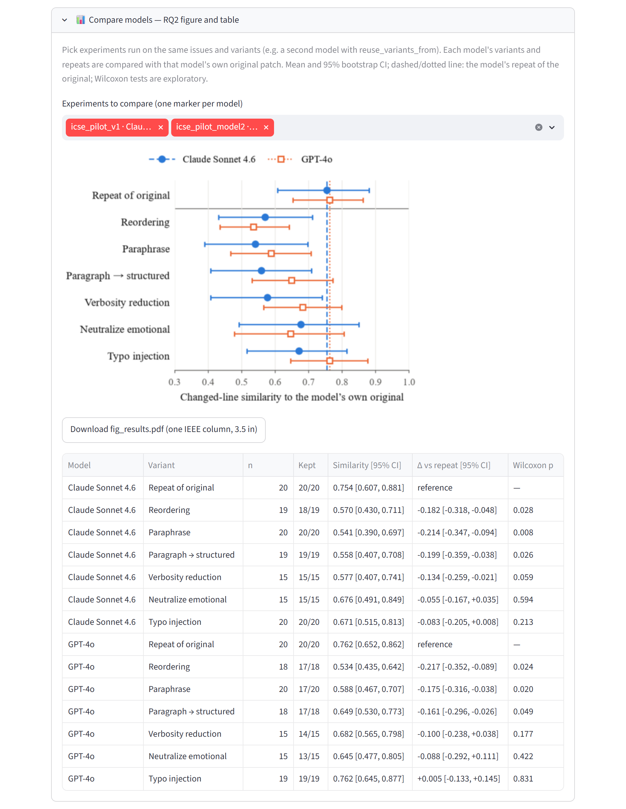

# StableAgent

StableAgent checks whether a software-engineering agent behaves the same way when the same issue
is described in different words. It rewrites SWE-bench Lite issues with meaning-preserving
transformations (paraphrase, shorter text, typos, reordered paragraphs, a structured bug report, a
neutral tone), runs the agent on the original and on every variant, and reports whether the
outcome changes (RQ1, stability) and how much the patch changes (RQ2, transformation
sensitivity). It has a Streamlit GUI, a command-line interface, and a replay mode that reproduces
the ICSE 2027 pilot (Claude Sonnet 4.6 and GPT-4o) from recorded outputs, for free and without an
API key.



## Option A: Docker (recommended)

```bash
docker pull ghcr.io/at-walid/stableagent:1.0.0
docker run -p 8501:8501 ghcr.io/at-walid/stableagent:1.0.0
```

Then open http://localhost:8501. The GUI starts in replay mode: no API key is needed.

- Live mode: add `-e ANTHROPIC_API_KEY=<your key>` and/or `-e OPENAI_API_KEY=<your key>` to
  `docker run`. Keys are only read at run time; they are never stored in the image.
- Keep the database and the exports between runs: add `-v ./results:/app/results` (on Linux,
  create `results/` first; the container runs as user 1000).
- Use the CLI: append a command, for example
  `docker run --rm ghcr.io/at-walid/stableagent:1.0.0 stableagent run --config configs/icse_pilot.json --estimate`
- Alternative: `docker compose up` builds the image from this repository and starts the GUI with
  the same settings and a `./results` volume (keys are taken from your shell or a `.env` file).
- Build it yourself: `docker build -t stableagent:1.0.0 .`

## Option B: install the packages yourself

Requires Python 3.11.

```bash
git clone https://github.com/At-Walid/stableagent.git
cd stableagent
python3.11 -m venv .venv
source .venv/bin/activate          # Windows: .venv\Scripts\activate
pip install -r requirements.txt
pip install -e .
streamlit run stableagent/dashboard/StableAgent.py
```

Then open http://localhost:8501. On first start the working database `stableagent.db` is created
as a copy of the shipped pilot database (`data/pilot/stableagent_pilot.db`), so the 300 bundled
SWE-bench Lite issues and both pilot experiments are there at once. Set `DATABASE_URL` to use
another database file, or `STABLEAGENT_SEED_DB=` (empty) to start from an empty one. For live
mode, put your keys in a `.env` file (see `.env.example`).

CLI examples:

```bash
stableagent --help
stableagent list-experiments
stableagent run --config configs/icse_pilot.json --mode mock    # replay the Claude pilot
stableagent run --config configs/icse_demo.json --mode mock     # 5-issue demo
stableagent preview --issue psf__requests-2317 --transform paraphrase
stableagent export --experiment-id 1 --format csv               # also json, md
```

Tests need no API key and no network: `pip install -r requirements-dev.txt`, then `pytest`.

## Replay mode and live mode

|  | Replay (MockReplay agent) | Live (LLM Baseline agent) |
|---|---|---|
| Agent outputs | recorded during the pilot (`stableagent/fixtures/mock_responses/`, one set per model) | one call per variant to `claude-sonnet-4-6` or `gpt-4o`, temperature 0 |
| Issue variants | the variants the pilot ran on | generated by `claude-haiku-4-5-20251001` (LLM-backed transformations) and cached; the deterministic ones are computed |
| API key | not needed | `ANTHROPIC_API_KEY` (Claude, and variant generation); `OPENAI_API_KEY` (GPT-4o) |
| Cost | free, offline | API credits |
| Results | the paper's numbers, exactly | new agent outputs, so the numbers can differ from the paper |

In the GUI, choose the agent in section B: MockReplay, LLM Baseline (Claude Sonnet 4.6) or LLM
Baseline (GPT-4o). Replay works for the issues marked "✓ replayable": the 20 pilot issues (all six
transformations, plus one repeat of each original) and 5 demo issues. *Past Experiments* holds
both recorded pilot experiments; *Compare models* shows them side by side. Never set a key on a
public deployment: every visitor could use it.

## Reproducing the ICSE pilot

Two experiments on the same 20 SWE-bench Lite issues, six transformations and one repeat of each
original (160 runs each). The second model runs on exactly the variants of the first
(`"reuse_variants_from"` in its config), so both see the same texts.

| | Claude Sonnet 4.6 (`configs/icse_pilot.json`) | GPT-4o (`configs/icse_pilot_model2.json`) |
|---|---|---|
| Originals localized (gold-patch files modified) | 20 / 20 | 17 / 20 |
| Variants that keep the original's outcome | 107 / 108 | 97 / 105 |
| Changed-line similarity, repeat of the original | 0.75 | 0.76 |
| Changed-line similarity, paraphrase | 0.54 | 0.59 |

Replies cut at the 4096-token limit (3 GPT-4o runs) are excluded, like timeouts.

**Replay (free).** In the GUI, open *Past Experiments*. From the command line:

```bash
stableagent run --config configs/icse_pilot.json --mode mock
stableagent run --config configs/icse_pilot_model2.json --mode mock
python scripts/analyze_patch_similarity.py     # both models, from data/pilot/exports/
```

The analysis prints RQ1 and RQ2 per model and writes the RQ2 figure (`fig_results.pdf`, one IEEE
column) and the combined table (CSV, Markdown, LaTeX) to `results/paper/`.

**Live, step by step.**

1. Select the issues with a structural rule (no agent outcome, no API call):
   ```bash
   python scripts/localizability.py --dataset-json data/swebench_lite_issues.json
   python scripts/select_pilot_issues.py
   ```
   This writes `scripts/output/pilot_issue_ids.json`, the 20 ids of both configs.
2. Load the issues: `python scripts/seed_pilot_issues.py` (the shipped database already has them).
3. Check the plan and the expected cost, without any API call:
   `stableagent run --config configs/icse_pilot.json --estimate`
4. Generate and quality-check the variants, without calling the agent:
   `stableagent run --config configs/icse_pilot.json --generate-only`
5. Run the first model: `stableagent run --config configs/icse_pilot.json` (capped at $5).
6. Run the second model on the same variants (`--estimate` first: 148 agent runs, 0 variants to
   generate): `stableagent run --config configs/icse_pilot_model2.json --mode real` (capped at $4).
   To use another model, change `provider` and `model` in that config; prices are in
   `stableagent/config/pricing.py`.
7. Export: `stableagent export --experiment-id <id> --format csv` (and `json`, `md`).
8. Analyze: `python scripts/analyze_patch_similarity.py --experiments <first id> <second id>`

To replay a run later, record it: `stableagent record-fixtures --experiment-id <id>`.

Observed costs (October 2026): about $1.40 for the Claude agent runs and $0.70 for the GPT-4o
agent runs, plus about $0.17 for generating the variants with `claude-haiku-4-5-20251001`. API
prices may change; `--estimate` prints the expected cost before anything runs.

The recorded pilot is in `data/pilot/`: the database `stableagent_pilot.db` and the exports of
each experiment in `exports/claude-sonnet-4-6/` and `exports/gpt-4o/` (`runs.csv`, `metrics.csv`,
`experiment_results.json`, `experiment_report.md`), built by `scripts/build_pilot_db.py`.

## Extending

### Adding an agent adapter

```python
# stableagent/agents/my_agent.py
from stableagent.agents.base import AbstractAgentAdapter, AgentInput, AgentOutput, ExecutionMode
from stableagent.agents.registry import agent_registry


@agent_registry.register
class MyAgentAdapter(AbstractAgentAdapter):
    name = "my_agent"
    version = "0.1"
    supported_modes = [ExecutionMode.REAL]

    def configure(self, params: dict) -> None:
        self.params = params  # the agent's "params" in the experiment config

    def run(self, agent_input: AgentInput, mode: ExecutionMode) -> AgentOutput:
        patch = call_my_agent(agent_input.repo_name, agent_input.issue_text)  # a unified diff
        return AgentOutput(status="success" if patch else "no_patch", patch=patch)

    def health_check(self) -> bool:
        return True
```

Import the module in `stableagent/agents/__init__.py` and use `"name": "my_agent"` in the
`agents` list of a config. The outcome is computed from the patch (does it modify the files of the
gold patch?); the gold patch never reaches the agent.

### Adding a transformation

```python
# stableagent/transformations/deterministic/greeting.py
from stableagent.transformations.base import (
    AbstractTransformation, IssueRecord, TransformedIssue,
)
from stableagent.transformations.registry import register


@register
class Greeting(AbstractTransformation):
    name = "greeting"
    category = "deterministic"  # LLM-backed ones subclass llm_backed/base.py (code masking, retry)
    transform_version = "1"     # bump it whenever the output for the same input can change

    def transform(self, issue: IssueRecord, params: dict) -> TransformedIssue:
        return TransformedIssue(
            original_issue_id=issue.issue_id,
            transformation_name=self.name,
            transformation_params=params,
            transformed_text="Hi, I ran into the following problem.\n\n" + issue.text,
            transformation_notes="Added a greeting line.",
        )
```

Import the module in `stableagent/transformations/__init__.py` and add
`{"name": "greeting", "enabled": true, "params": {}}` to the `transformations` of a config; to
offer it in the GUI, add it to `_TRANSFORMS` in `stableagent/dashboard/StableAgent.py`. Every
variant goes through the same cache and quality checks (technical identifiers kept, no-op variants
excluded).

## Project structure

```
stableagent/               the Python package
  agents/                  agent adapters: LLM Baseline (Anthropic or OpenAI), MockReplay;
                           stubs for OpenHands, SWE-agent, Aider, AutoCodeRover
  transformations/         the six transformations, quality checks, variant cache
  execution/               experiment runner, cost guard, variant reuse
  metrics/                 outcome, success consistency, stability score, sensitivity,
                           changed-line similarity, statistics, per-model comparison
  dashboard/               Streamlit GUI (StableAgent.py, pages/)
  cli/                     the stableagent command
  export/                  CSV, JSON and Markdown exports, the RQ2 figure and table
  fixtures/mock_responses/ recorded agent outputs replayed by MockReplay (gpt-4o/ for GPT-4o)
configs/                   experiment configs (icse_pilot.json, icse_pilot_model2.json,
                           icse_demo.json)
data/                      the 300 bundled SWE-bench Lite issues; pilot/: pilot database and exports
scripts/                   issue selection, seeding, analysis, pilot database builder
docs/                      SPEC.md (design specification), DEPLOY.md, ARCHIVE.md, img/, paper/
tests/                     unit and integration tests (no API key, no network)
Dockerfile, docker-compose.yml, requirements.txt, requirements-dev.txt
```

`data/swebench_lite_issues.json` holds the 300 test issues of
[princeton-nlp/SWE-bench_Lite](https://huggingface.co/datasets/princeton-nlp/SWE-bench_Lite)
(revision 6ec7bb89), with the problem statements verbatim and the gold patches as hidden ground
truth. The dataset card declares no license: the issue texts belong to their authors and the
patches to their projects.

## Citation

Cite the tool with the metadata in [`CITATION.cff`](CITATION.cff) (on GitHub: *Cite this
repository*).

## License

MIT, see [LICENSE](LICENSE).

## Contact

Mohamed Oualid Attaoui (LIRMM), mohammed.attaoui@lirmm.fr. Questions and bug reports: GitHub
issues on this repository.
