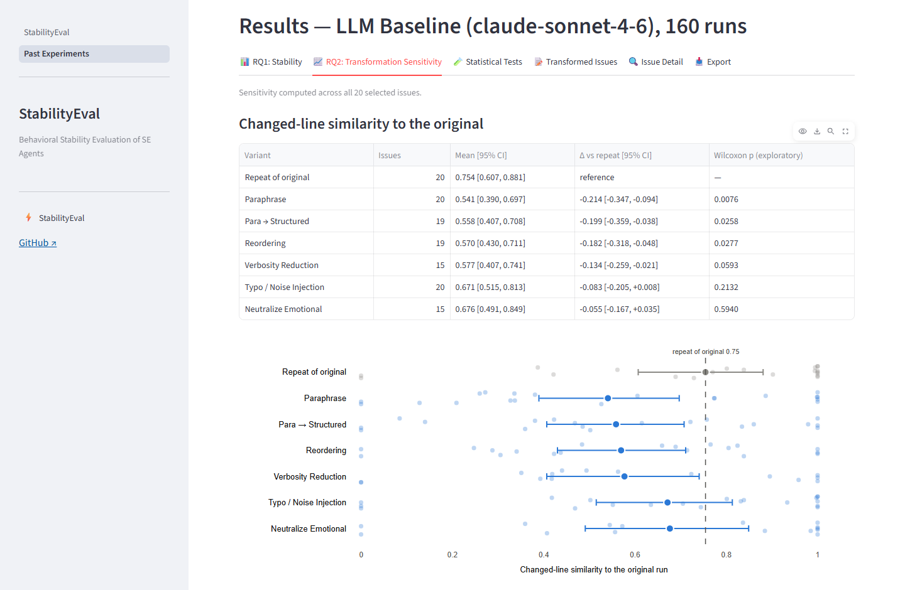

# StabilityEval

StabilityEval checks whether an autonomous software-engineering agent behaves the same way when
the same issue is described in different words. It rewrites a SWE-bench Lite issue with
meaning-preserving transformations (paraphrase, shorter text, typos, reordered paragraphs, a
structured bug report, a neutral tone), runs the agent on the original and on every variant, and
reports whether the outcome changes (RQ1, stability) and how much the patch changes (RQ2,
transformation sensitivity). It has a Streamlit GUI and a command-line interface, and a replay
mode that re-runs the ICSE 2027 pilot from recorded agent outputs, for free and without an API key.



Demo video: TODO. Public demo: TODO. Archived release (Zenodo): TODO DOI.

## Quick start, option A: Docker (recommended)

```bash
docker pull ghcr.io/at-walid/stabilityeval:1.0.0
docker run -p 8501:8501 ghcr.io/at-walid/stabilityeval:1.0.0
```

Open http://localhost:8501. The GUI starts in replay mode: no API key is needed.

- To keep the database and the exports, mount a results folder:
  `docker run -p 8501:8501 -v ./results:/app/results ghcr.io/at-walid/stabilityeval:1.0.0`
  (on Linux, create `results/` first; the container runs as user 1000).
- Live mode: add `-e ANTHROPIC_API_KEY=sk-ant-...`, or paste the key in the GUI. The key is never
  stored in the image.
- The CLI: append a command, for example
  `docker run --rm ghcr.io/at-walid/stabilityeval:1.0.0 stabilityeval run --config configs/icse_pilot.json --estimate`
- With Docker Compose, `docker compose up` builds the image from this repository and starts the
  GUI with the same settings.

## Quick start, option B: local install

Requires Python 3.11.

```bash
git clone https://github.com/At-Walid/stabilityeval.git
cd stabilityeval
python3.11 -m venv .venv
source .venv/bin/activate          # Windows: .venv\Scripts\activate
pip install -r requirements.txt
pip install -e .
streamlit run stability_eval/dashboard/StabilityEval.py
```

On first use, the database `stabilityeval.db` is created as a copy of the shipped pilot database
(`data/pilot/stabilityeval_pilot.db`): the 300 bundled SWE-bench Lite issues and the pilot
experiment are available right away. Set `STABILITYEVAL_SEED_DB=` (empty) to start from an empty
database instead, and `DATABASE_URL` to use another file.

CLI examples:

```bash
stabilityeval --help
stabilityeval list-experiments
stabilityeval run --config configs/icse_pilot.json --mode mock    # replay the pilot
stabilityeval run --config configs/icse_demo.json --mode mock     # 5-issue demo
stabilityeval preview --issue psf__requests-2317 --transform paraphrase
stabilityeval export --experiment-id 1 --format csv               # also json, md
```

Tests need no API key and no network: `pip install -r requirements-dev.txt`, then `pytest`.

## Replay mode and live mode

|  | Replay (MockReplay agent) | Live (LLM Baseline agent) |
|---|---|---|
| Agent outputs | recorded during the pilot (`stability_eval/fixtures/mock_responses/`) | one call to `claude-sonnet-4-6` per variant, temperature 0 |
| Issue variants | the variants the pilot ran on | generated by `claude-haiku-4-5-20251001` (LLM-backed transformations) and cached; the deterministic ones are computed |
| API key | not needed | `ANTHROPIC_API_KEY` |
| Cost | free, offline | API credits (the pilot cost about $1.60) |
| Results | the paper's numbers, exactly | new agent outputs, so the numbers can differ from the paper |

In the GUI, choose the agent in section B. Replay works for the issues marked "✓ replayable": the
20 pilot issues (all six transformations, plus one repeat of each original) and 5 demo issues.
For live mode in the GUI, paste the key in the key field (it stays in the browser session) or set
`ANTHROPIC_API_KEY` in the environment. For the CLI, set it in the environment or in a `.env`
file (see `.env.example`). Never set a key on a public deployment: every visitor could use it.

## Reproducing the ICSE pilot

The pilot runs the LLM Baseline on 20 SWE-bench Lite issues, six transformations and one repeat of
each original: 160 runs. Results: the agent localizes the right file on 20 of 20 originals; 107 of
the 108 scored variants keep the original's outcome; the changed-line similarity of a patch to the
original's patch is 0.75 for a plain repeat and 0.54 for a paraphrase.

**Replay (free).** In the GUI, open *Past Experiments* and click `icse_pilot_v1` (the recorded run),
or replay it: issue set *ICSE pilot*, select all 20 issues, enable all six transformations, keep
MockReplay, click *Run Experiment*. From the command line:

```bash
stabilityeval run --config configs/icse_pilot.json --mode mock
python scripts/analyze_patch_similarity.py           # from data/pilot/exports/runs.csv
```

**Live, step by step.**

1. Select the issues with a structural rule (no agent outcome, no API call):
   ```bash
   python scripts/localizability.py --dataset-json data/swebench_lite_issues.json
   python scripts/select_pilot_issues.py
   ```
   This writes `scripts/output/pilot_issue_ids.json`, the 20 ids of `configs/icse_pilot.json`.
   Without `--dataset-json`, `localizability.py` downloads SWE-bench Lite from Hugging Face instead;
   the result is the same.
2. Load the issues: `python scripts/seed_pilot_issues.py` (the shipped database already has them).
3. Check the plan and the expected cost, without any API call:
   `stabilityeval run --config configs/icse_pilot.json --estimate`
4. Generate and quality-check the variants, without calling the agent:
   `stabilityeval run --config configs/icse_pilot.json --generate-only`
   (the shipped database already holds the pilot's variants, so this costs nothing unless you start
   from an empty database).
5. Run: `stabilityeval run --config configs/icse_pilot.json` (the config caps the cost at $5).
6. Export: `stabilityeval export --experiment-id <id> --format csv` (and `json`, `md`), written to
   `results/icse_pilot_v1/`.
7. Analyze: `python scripts/analyze_patch_similarity.py --runs results/icse_pilot_v1/runs.csv`

To replay your own run later, record it: `stabilityeval record-fixtures --experiment-id <id>`.

Observed cost of the full pilot: about $1.60 (October 2026): $1.42 for the 160 agent runs with
`claude-sonnet-4-6` and about $0.17 for generating the variants with `claude-haiku-4-5-20251001`.
API prices may change; `--estimate` prints the expected cost before anything runs.

The recorded pilot is in `data/pilot/`: the database `stabilityeval_pilot.db` and its exports
(`runs.csv`, `metrics.csv`, `experiment_results.json`, `experiment_report.md`).
`scripts/build_pilot_db.py` documents how they were extracted from the run.

## Extending

### Adding an agent adapter

```python
# stability_eval/agents/my_agent.py
from stability_eval.agents.base import AbstractAgentAdapter, AgentInput, AgentOutput, ExecutionMode
from stability_eval.agents.registry import agent_registry


@agent_registry.register
class MyAgentAdapter(AbstractAgentAdapter):
    name = "my_agent"
    version = "0.1"
    supported_modes = [ExecutionMode.REAL]

    def configure(self, params: dict) -> None:
        self.params = params  # the agent's "params" in the experiment config

    def run(self, agent_input: AgentInput, mode: ExecutionMode) -> AgentOutput:
        patch = call_my_agent(agent_input.repo_name, agent_input.issue_text)  # a unified diff
        return AgentOutput(status="success" if patch else "no_patch", patch=patch)

    def health_check(self) -> bool:
        return True
```

Import the module in `stability_eval/agents/__init__.py` and use `"name": "my_agent"` in the
`agents` list of a config. The outcome is computed from the patch (does it modify the files of the
gold patch?); the gold patch never reaches the agent.

### Adding a transformation

```python
# stability_eval/transformations/deterministic/greeting.py
from stability_eval.transformations.base import (
    AbstractTransformation, IssueRecord, TransformedIssue,
)
from stability_eval.transformations.registry import register


@register
class Greeting(AbstractTransformation):
    name = "greeting"
    category = "deterministic"  # LLM-backed ones subclass llm_backed/base.py (code masking, retry)
    transform_version = "1"     # bump it whenever the output for the same input can change

    def transform(self, issue: IssueRecord, params: dict) -> TransformedIssue:
        return TransformedIssue(
            original_issue_id=issue.issue_id,
            transformation_name=self.name,
            transformation_params=params,
            transformed_text="Hi, I ran into the following problem.\n\n" + issue.text,
            transformation_notes="Added a greeting line.",
        )
```

Import the module in `stability_eval/transformations/__init__.py` and add
`{"name": "greeting", "enabled": true, "params": {}}` to the `transformations` of a config; to
offer it in the GUI, add it to `_TRANSFORMS` in `stability_eval/dashboard/StabilityEval.py`.
Every variant goes through the same cache and quality checks (technical identifiers kept, no-op
variants excluded).

## Project structure

```
stability_eval/            the Python package
  agents/                  agent adapters: LLM Baseline, MockReplay; stubs for OpenHands,
                           SWE-agent, Aider, AutoCodeRover
  transformations/         the six transformations, quality checks, variant cache
  execution/               experiment runner, cost guard
  metrics/                 outcome, success consistency, stability score, sensitivity,
                           changed-line similarity, statistics
  dashboard/               Streamlit GUI (StabilityEval.py, pages/)
  cli/                     the stabilityeval command
  export/                  CSV, JSON and Markdown exports
  fixtures/mock_responses/ recorded agent outputs replayed by MockReplay
configs/                   experiment configs (icse_pilot.json, icse_demo.json)
data/                      the 300 bundled SWE-bench Lite issues; pilot/: pilot database and exports
scripts/                   issue selection, seeding, analysis, bundle and fixture builders
docs/                      SPEC.md (design specification), DEPLOY.md, ARCHIVE.md, img/
tests/                     unit and integration tests (no API key, no network)
Dockerfile, docker-compose.yml, requirements.txt, requirements-dev.txt
```

`data/swebench_lite_issues.json` holds the 300 test issues of
[princeton-nlp/SWE-bench_Lite](https://huggingface.co/datasets/princeton-nlp/SWE-bench_Lite)
(revision 6ec7bb89), with the problem statements verbatim and the gold patches as hidden ground
truth. The dataset card declares no license: the issue texts belong to their authors and the
patches to their projects.

## Citation

Cite the tool with the metadata in [`CITATION.cff`](CITATION.cff) (on GitHub: *Cite this
repository*). The archived release will have a Zenodo DOI: TODO.

## License

MIT, see [LICENSE](LICENSE).

## Contact

Mohamed Oualid Attaoui. Questions and bug reports: GitHub issues on this repository. Email: TODO.
